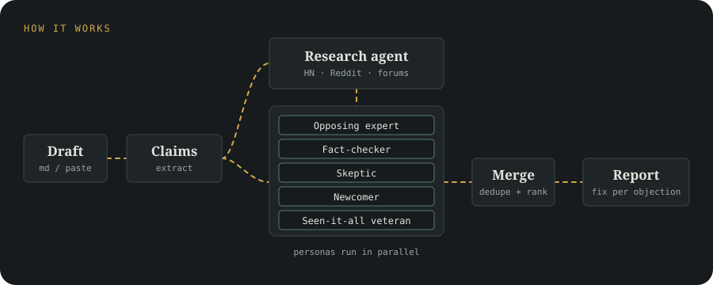

<p align="center">
  
</p>

> **Status: design phase.** The design spec is written and approved; the skill itself is not built yet. This README describes what Gadfly will do. Nothing below is installable today.

## The name

Socrates called himself the *gadfly* of Athens: the annoying fly that stings a sleepy horse awake. Gadfly does that to your draft. It finds the objections, the gaps and the "well, actually" comments **before** your readers do, then turns each one into a concrete fix.

It exists because most criticism is predictable. Write "quitting to-do apps doubled my productivity" and someone will ask "doubled, measured how?". Gadfly asks that first, while you can still fix the post.

## How it works

<p align="center">
  
</p>

1. **Claims.** Gadfly extracts your main claims, comparisons and technical assertions.
2. **Research.** A research agent searches Hacker News, Reddit and forums for the criticism similar posts actually received.
3. **Personas, in parallel.** Each persona reads the draft plus the research and objects from its own angle.
4. **Merge.** Duplicates are removed. Every objection gets a severity, an evidence tag and an action.
5. **Report.** Ranked by severity, with real-world evidence kept apart from simulation.

### Starter personas

| Persona | Hunts for |
|---|---|
| Opposing expert (knows the field, disagrees with you) | Strawmen, outdated practices, unfair comparisons |
| Fact-checker | Wrong claims, missing sources, unsupported numbers |
| Skeptic | Cherry-picking, hype, missing counter-evidence |
| Newcomer | Undefined jargon, assumed knowledge |
| Seen-it-all veteran | "This is already known", prior art |

## What you get

<p align="center">
  
</p>

The report above is an illustrative example, not real output.

Every objection carries:

- **Severity:** HIGH / MED / LOW, always as a label, never color alone
- **Evidence:** `research` (seen in real discussions, with a source link) or `persona` (simulated only)
- **Fix:** rewrite, add a source, narrow the scope, or pre-empt it in the text

If web access fails, the report says so and continues as simulation-only.

## Roadmap

| Version | Scope |
|---|---|
| **v1** | Pre-publish content: blog posts, LinkedIn posts |
| **v2** | Technical projects and ideas: architecture critic, security, scalability and "this is already solved by X" personas; GitHub issues and competing projects as research sources; personas picked automatically from the input type |

Out of scope for now: auto-rewriting your draft, a web UI, a stored library of past critiques.

## Project layout (planned)

```
gadfly/
  SKILL.md                 orchestration
  personas/content/*.md    v1 personas
  personas/technical/*.md  v2 personas
  report-template.md
  assets/                  logo and README visuals
  docs/                    spec and brand guidelines
```

## Brand

Colors, typography, voice and logo rules live in [`docs/brand-guidelines.md`](docs/brand-guidelines.md). Design tokens are in `assets/design-tokens.css`.

<p align="center">
  <picture>
    <source media="(prefers-color-scheme: dark)" srcset="assets/logo-horizontal-dark.svg">
    
  </picture>
</p>
